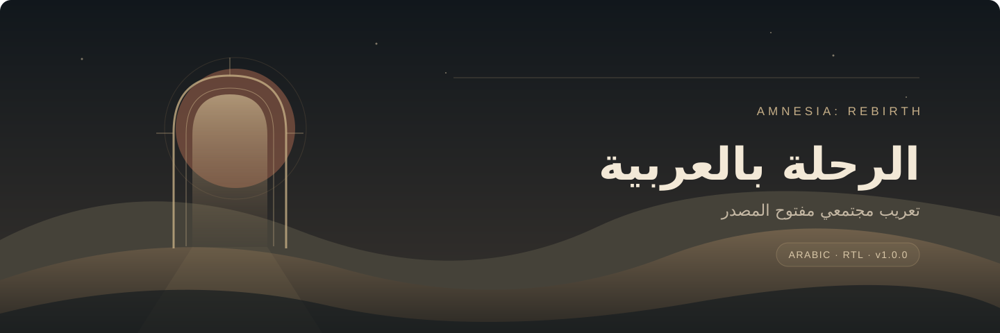
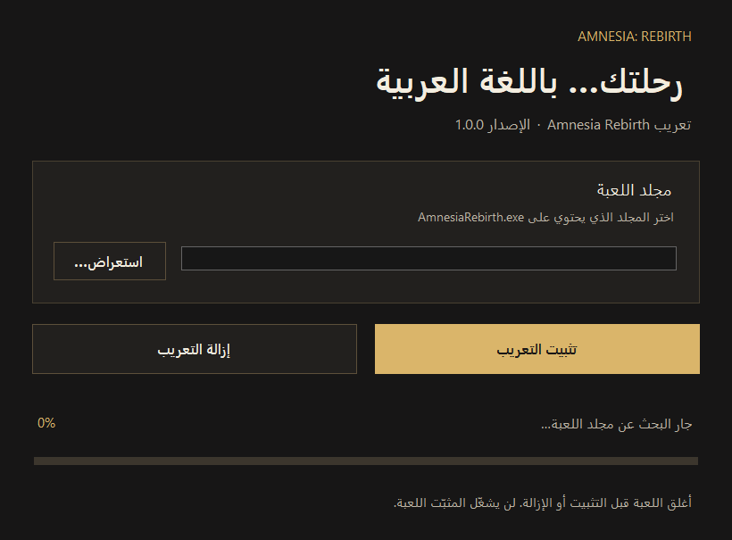

  

  
  
  
  

<h1 align="center">تعريب Amnesia: Rebirth</h1>

القصة، الحوارات، اليوميات، الواجهة والتترات بالعربية. مشروع مجتمعي مفتوح المصدر، مع خط عربي وإصلاح لاتجاه ظهور النص تدريجيا.

## التنزيل

| الحزمة | الاستخدام |
| :--- | :--- |
| **[تنزيل المثبت EXE — الإصدار 1.0.0](https://github.com/exelight7/Amnesia_Rebirth_AR/releases/download/v1.0.0/Amnesia_Rebirth_AR_1.0.0_Setup.exe)** | تثبيت بواجهة رسومية، مع نسخ احتياطي وإزالة التعريب. |
| **[تنزيل الحزمة اليدوية ZIP — الإصدار 1.0.0](https://github.com/exelight7/Amnesia_Rebirth_AR/releases/download/v1.0.0/Amnesia_Rebirth_AR_1.0.0_Manual.zip)** | تثبيت وإزالة عبر PowerShell. |
| [صفحة الإصدار](https://github.com/exelight7/Amnesia_Rebirth_AR/releases/tag/v1.0.0) | ملفات الإصدار وملاحظاته. |

تحتاج إلى **نسخة مملوكة من اللعبة على Windows**. الدعم مرتبط ببصمة ملف اللعبة، وليس بكل إصدار يحمل الاسم نفسه. راجع [التوافق وحدود الاختبار](docs/COMPATIBILITY.md).

## التثبيت

1. أغلق اللعبة، ونزل المثبت من الرابط أعلاه.
2. شغله بصلاحيات المسؤول، وحدد مجلد اللعبة الذي يحتوي على `AmnesiaRebirth.exe`، ثم أكمل التثبيت.
3. شغل اللعبة بالطريقة المعتادة من Steam. في إعدادات اللغة، اختر خانة **English** التي تظهر باسم **العربية** بعد التعريب، وفعل الترجمة إن لم تكن مفعلة.

يستخدم التعريب خانة اللغة الإنجليزية ويثبت الخط العربي وإصلاح الظهور التدريجي. يحتفظ المثبت بنسخة احتياطية من الحالة السابقة، وتعيد الإزالة تلك الحالة. قد تتجاوز إعدادات ملفك الشخصي القديم الإعدادات الافتراضية؛ عندها اختر اللغة وفعل الترجمة يدويا داخل اللعبة.

لإزالة التعريب، استخدم خيار الإزالة في المثبت، أو اتبع [دليل التثبيت اليدوي والإزالة](docs/INSTALLATION.md). لا تحذف النسخ الاحتياطية قبل الإزالة.

## ما الذي يتضمنه الإصدار؟

| المحتوى | العدد |
| :--- | ---: |
| مواضع النصوص في ملفات اللغة | 4,558 |
| مواضع النصوص في التترات | 450 |
| **إجمالي المواضع المغطاة** | **5,008** |
| مواضع تحتوي على نص عربي | 4,613 |
| مواضع محفوظة كما تقتضي وظيفتها، مثل الرموز والأسماء والمفاتيح | 393 |
| مواضع فارغة في الأصل | 2 |

هذه أعداد **مواضع النصوص**، وتشمل التكرار بين الملفات. تتضمن المراجعة اللغوية الأخيرة **52 تصحيحا** للمعنى والضمائر والنحو والصياغة.

الخط مبني من **IBM Plex Sans Arabic** بتسعة أحجام، و**1,021 محرفا**، ضمن **21 ملف خط وأطلس**. تحفظ أدوات البناء رموز التحكم والمتغيرات والفواصل الخاصة باللعبة أثناء تجهيز النص العربي.

## حالة الاختبار

اجتاز البناء فحوص التغطية والرموز والخطوط، وخضع إصلاح الظهور التدريجي لفحوص ساكنة واختبارات حسابية. **لم يجر التحقق داخل اللعبة بعد هذا الإصلاح، ولم تنجز جولة لعب كاملة حتى النهاية.** التغطية النصية الكاملة لا تعني اعتماد كل شاشة بصريا؛ نرحب ببلاغات قص النص أو اتجاهه أو ترجمته مع صورة والسياق.

## المصدر والمساهمة

النص العربي محفوظ بترتيبه المنطقي في `localization/arabic.json`. تولد الأدوات نسخة العرض وحزمة التثبيت، ويستخدم المثبت الرسومي واليدوي محرك التثبيت نفسه.

- [دليل البناء من المصدر](docs/BUILD.md)
- [دليل المساهمة والإبلاغ عن الأخطاء](docs/CONTRIBUTING.md)
- [التوافق والفحوص](docs/COMPATIBILITY.md)
- [فتح بلاغ](https://github.com/exelight7/Amnesia_Rebirth_AR/issues)

## الحقوق

الكود والترجمة من أعمال المشروع مرخصان وفق **[MIT](LICENSE)**، مع الحفاظ على إشعار حقوق `kaitolight7`. يخضع خط **IBM Plex Sans Arabic** لرخصة **SIL Open Font License 1.1** المرفقة في `fonts/source/OFL.txt`.

هذا مشروع غير رسمي، ولا تربطه صلة رسمية بـ **Frictional Games**. حقوق اللعبة وعلاماتها وأصولها الأصلية لأصحابها. لا يتضمن التنزيل اللعبة أو ملفها التنفيذي؛ تطبق الأداة بيانات تعديل صغيرة على نسختك المحلية، وتعيد بناء ملفات اللغة من ملفات اللعبة الموجودة لديك.

